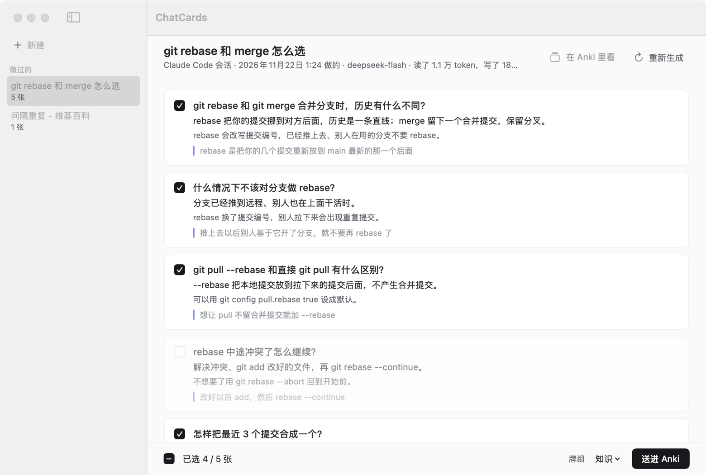
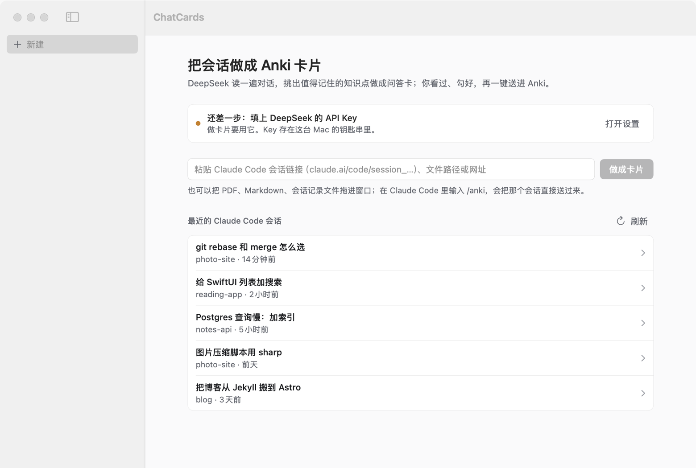

# ChatCards

[中文](README.md)

A Mac app that turns Claude Code sessions, PDFs, Markdown files and web pages into Anki cards. DeepSeek reads the material and picks out what is worth remembering as question and answer cards; you review, edit and tick them in the app, then send them to Anki in one click.

> Formerly Anki Learn. If you used Anki Learn, the first launch of ChatCards brings over your cards, settings and DeepSeek key; see "Where your data lives".

The interface is in Chinese for now.

<picture>
  <source media="(prefers-color-scheme: dark)" srcset="docs/screenshots/cards-dark.png">
  
</picture>

## What you need

- A Mac with Apple silicon, macOS 14 or later.
- [Anki](https://apps.ankiweb.net) for desktop with the AnkiConnect add-on (code `2055492159`).
- A DeepSeek API key ([DeepSeek platform](https://platform.deepseek.com/api_keys)). The default model costs about 1 US cent for a 10,000-character conversation.

## Install

There is no prebuilt download yet. Build it from source:

```bash
brew install xcodegen      # Xcode is needed as well
git clone https://github.com/SchaeferAnjon/chatcards.git && cd chatcards
make install               # builds Release and copies it to /Applications/ChatCards.app
```

On first launch, enter your DeepSeek key in Settings. The Anki page in Settings checks, line by line, whether Anki is installed, whether AnkiConnect is installed and whether Anki is running, and offers a button for whichever step is missing.

## Giving it something to read



- **Pick one of the recent Claude Code sessions** on the home page. They are read from `~/.claude/projects`. Sessions run by `claude -p` scripts are not listed.
- **Paste a claude.ai/code/session_… link** (the field on the home page, or Edit › Import Link from Clipboard, ⇧⌘V). The app finds the full transcript on this Mac through its `bridgeSessionId`; no sign-in needed. A session that is not on this Mac opens in the app's web window (sign in to claude.ai the first time).
- **Type `/anki` in Claude Code** to send the current session. Copy the `ClaudeSkill/anki` folder to `~/.claude/skills/anki` first.
- **Drop a PDF, Markdown file or .jsonl transcript on the window.** A pasted web address opens in the web window; click the button there to make cards from that page. Scanned PDFs without a text layer are not supported yet.

## Making cards

- The default model is `deepseek-flash` with thinking on (Settings can switch to `deepseek-v4-pro` or turn thinking off). A session of 11,000 tokens took 49 seconds and gave 14 cards.
- Long material is split into pieces of 120,000 characters, up to 3 sent at a time; cards with the same question are kept once.
- Only the conversation itself is read: what you wrote and what the AI answered. Tool calls, tool results, thinking, sub-agents, system reminders and compaction summaries are left out.
- One idea per card, a question that makes sense outside the conversation, an answer of about 40 Chinese characters at most, and one quoted line from the source. The prompt is in `Core/Sources/ChatCardsCore/CardMaker.swift`.

## Sending to Anki

- Anki has to be running. If it is not, the notice offers to open Anki and sends as soon as it connects; if Anki runs but the add-on does not answer, the notice shows how to install it.
- Cards go to the deck 知识 ("knowledge") by default; the deck menu at the bottom also lists the 知识::… decks you created in Anki. The app remembers the deck by its id, so renaming it in Anki is fine. The default deck name can be changed in Settings.
- The note type is 学习卡 · 问答 with nine fields: `Question`, `Answer`, `More`, `Quote`, `Image`, `Label`, `Source`, `Link`, `ID`, styled for light and dark mode. GetNewWord and Ask Free by the same author write to the same note type, so all cards look alike. If Anki already has a note type of that name with different fields, the app leaves it alone and uses 学习卡 · 问答 2.
- If you edited the note type's template in Anki, the app asks once whether to replace it with the new look or keep yours. It never overwrites silently.
- Every card is tagged `来自::ChatCards` and `主题::<topic>`.
- A card whose question already exists in the deck is not added again. Cards already sent are marked as in Anki; regenerating keeps them and only replaces the ones not yet sent.

## Where your data lives

- DeepSeek API key: the login keychain (service `io.github.schaeferanjon.chatcards`); it is only sent to `api.deepseek.com`.
- Sources and cards: `~/Library/Application Support/ChatCards/sources.json`.
- Settings: `defaults read io.github.schaeferanjon.chatcards`.
- Coming from Anki Learn: the first launch copies `~/Library/Application Support/Anki Learn/sources.json`, the `com.ankilearn.app` settings and the key in the keychain. Nothing ChatCards already has is overwritten, and nothing on the Anki Learn side is deleted. macOS may ask once whether ChatCards may use the keychain item com.ankilearn.app; choose Allow or Always Allow. If you deny it, enter the key again in Settings. Afterwards you can delete `/Applications/Anki Learn.app`.
- Your conversations and files are only sent to DeepSeek; cards go into your Anki only through the local AnkiConnect (`127.0.0.1:8765`). No account, no analytics.

## Development

```bash
make test      # core tests: reading sessions, splitting, parsing cards, DeepSeek and AnkiConnect requests (fake servers)
make build     # Release build into build/
make install   # Release build, copied to /Applications/ChatCards.app
```

- `project.yml` (XcodeGen) is the only project definition; `ChatCards.xcodeproj` is not in git. Logic lives in `Core/` (a Swift package, testable on its own with `swift test`), the interface in `App/` (SwiftUI). Interface rules are in `DESIGN.md` (Chinese).
- Builds are ad-hoc signed by default, so anyone can build. With ad-hoc signing the keychain asks again for access to the key after every rebuild; signing with your own Apple Development certificate avoids that: `make install TEAM=<your Team ID>`, or create `local.mk` in the repository root (ignored by git) with the line `TEAM = <your Team ID>`.

- For testing and debugging, launch in test mode with `E2E=1` (or the launch argument `-E2E 1`): no window on screen, no focus stealing, no Dock icon; Finder, browser, opening Anki, alerts and pop-up menus are only logged (`App/TestMode.swift`). Cards live in a temporary folder (`E2E_DATA_DIR`), Claude sessions are read from `E2E_CLAUDE_DIR`, AnkiConnect goes to `E2E_ANKI_URL` (empty and unreachable when not given), preferences are a separate set and the key stays in memory, so your real data and your real Anki are never touched (`Core/Sources/ChatCardsCore/E2EMode.swift`). `E2E_SNAPSHOT=<png>` renders the main window to an image. `bash scripts/e2e-hidden-check.sh` builds a Debug copy, launches it in test mode, checks at 1, 5 and 10 seconds that no window is on screen, checks the snapshot and tries every action that could take over the screen.

## License

GPL-3.0-or-later, see [LICENSE](LICENSE). Anki is a trademark of Ankitects Pty Ltd; this app is not affiliated with Anki and talks to your local Anki through the AnkiConnect add-on.
