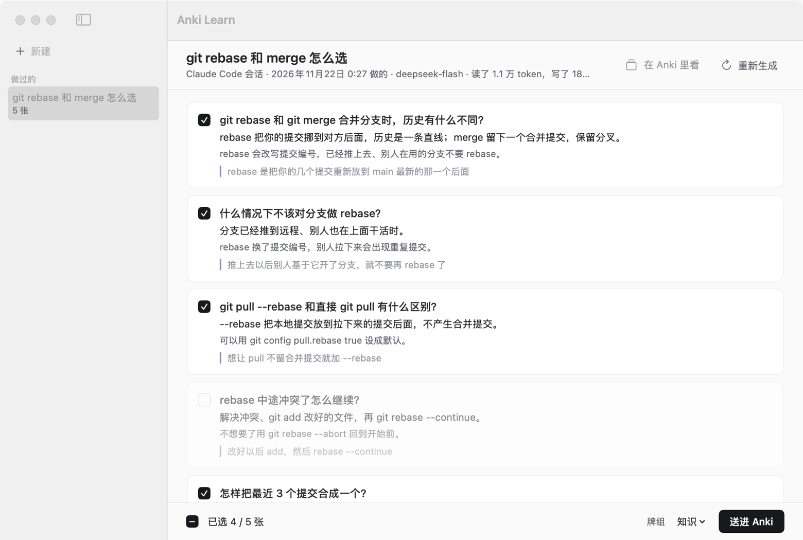
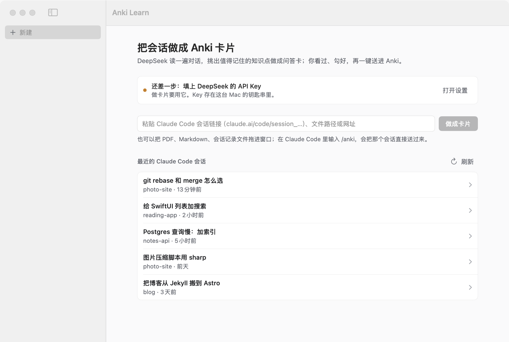

# Anki Learn

[English](README.en.md)

把 Claude Code 会话、PDF、Markdown 和网页做成 Anki 卡片的 Mac 应用。DeepSeek 读一遍内容，挑出值得长期记住的知识点做成问答卡；你在应用里看过、改好、勾好，再一键送进 Anki。

> 名字还会改：Anki 是 Ankitects 的注册商标，公开发布前这个应用会换一个不带「Anki」的名字。



## 要什么

- Apple 芯片的 Mac，macOS 14 或更新。
- [Anki](https://apps.ankiweb.net) 桌面版，装好 AnkiConnect 插件（编号 `2055492159`）。
- 一个 DeepSeek API Key（[DeepSeek 开放平台](https://platform.deepseek.com/api_keys)）。默认模型做一段 1 万字的对话大约 1 美分。

## 安装

现在还没有打好的安装包，从源码编：

```bash
brew install xcodegen      # 还要装好 Xcode
git clone <本仓库地址> && cd anki-learn
make install               # 编 Release，装到 /Applications/Anki Learn.app
```

第一次打开，在「设置」里填 DeepSeek 的 Key。设置里的「Anki」页会一行一行查：Anki 装了没有、AnkiConnect 插件装了没有、Anki 开着没有，缺哪一步就给哪一步的按钮。

## 怎么把内容交给它



- **首页「最近的 Claude Code 会话」点一个**。会话记录在 `~/.claude/projects` 里。`claude -p` 脚本跑的会话不列。
- **粘贴 claude.ai/code/session_… 链接**（首页输入框，或菜单「编辑 › 从剪贴板导入链接」⇧⌘V）：应用按会话记录里的 `bridgeSessionId` 在本机找到完整记录，不用登录。不在这台 Mac 上的会话在应用里的网页窗口打开（第一次要登录 claude.ai）。
- **在 Claude Code 里输入 `/anki`**：把当前会话直接送过来。先把 `ClaudeSkill/anki` 文件夹拷到 `~/.claude/skills/anki`。
- **把 PDF、Markdown、.jsonl 会话记录拖进窗口**；粘贴网址则在网页窗口里打开，点「用这页做卡片」。扫描版 PDF 读不出文字，还不支持。

## 出卡

- 模型默认 `deepseek-flash`，开着思考（设置里可换 `deepseek-v4-pro`、关思考）。实测一段 1.1 万 token 的会话 49 秒出 14 张卡。
- 长内容按 12 万字一段切开，最多 3 段同时发；问题一样的卡只留一张。
- 只读对话本身：你说的和 AI 的回答。工具调用、工具结果、思考过程、子 Agent、系统提醒、压缩摘要都去掉。
- 一张卡一个点，问题离开对话也看得懂，答案尽量不超过 40 字，带一句原文。提示词在 `Core/Sources/AnkiLearnCore/CardMaker.swift`。

## 送进 Anki

- 要开着 Anki。没开时提示条上有「打开 Anki 再送」，点了打开 Anki、连上就接着送；Anki 开着但连不上插件时提示「怎么装」。
- 牌组默认是「知识」，底栏的牌组菜单还会列出你在 Anki 里建的「知识::…」。应用按牌组的编号记它，你在 Anki 里给牌组改名，应用跟着走。默认牌组名能在设置里改。
- 笔记类型是「学习卡 · 问答」，九个字段：`Question`、`Answer`、`More`、`Quote`、`Image`、`Label`、`Source`、`Link`、`ID`，浅色深色都有样式。同一作者的 GetNewWord、Ask Free 也往这个笔记类型里写，卡长得一样。Anki 里已经有一个同名但字段对不上的笔记类型时，应用不碰它，改用「学习卡 · 问答 2」。
- 你在 Anki 里改过这个笔记类型的模板，应用送卡前先问一次「换成新样子」还是「留着我改的」，不悄悄覆盖。
- 每张卡带标签 `来自::ChatCards` 和 `主题::<主题>`。
- 同一牌组里问题一样的不重复加。送过的卡在应用里标「已在 Anki」；重新生成时留着它们，只换掉还没送的。

## 数据放在哪

- DeepSeek API Key：登录钥匙串（service `com.ankilearn.app`），只发给 `api.deepseek.com`。
- 做过的材料和卡片：`~/Library/Application Support/Anki Learn/sources.json`。
- 设置：`defaults read com.ankilearn.app`。
- 你的对话和文件内容只发给 DeepSeek；卡片只经本机的 AnkiConnect（`127.0.0.1:8765`）写进你的 Anki。没有账号，没有统计。

## 开发

```bash
make test      # 核心库测试：读会话、切段、解析卡片、DeepSeek 和 AnkiConnect 请求（假服务器）
make build     # 编 Release 到 build/
make install   # 编 Release，装到 /Applications/Anki Learn.app
```

- `project.yml`（XcodeGen）是唯一的工程定义，`AnkiLearn.xcodeproj` 不进 git。逻辑都在 `Core/`（Swift 包，能单独 `swift test`），界面在 `App/`（SwiftUI）。界面规范在 `DESIGN.md`。
- 默认用临时签名（ad-hoc）编，谁都能编。临时签名每次重新编译后，钥匙串会再问一次能不能读 Key；用你自己的 Apple Development 证书签就不会：`make install TEAM=<你的 Team ID>`，或者在仓库根目录建一个 `local.mk`（不进 git），写一行 `TEAM = <你的 Team ID>`。

## 许可证

GPL-3.0-or-later，见 [LICENSE](LICENSE)。Anki 是 Ankitects Pty Ltd 的商标；本应用和 Anki 官方没有关系，通过 AnkiConnect 插件和你本机的 Anki 通信。
